<div align="center">

# 🔐 Cybersecurity Lab Environment Setup

**Building an isolated virtual lab for penetration testing and ethical hacking practice**


</div>

---

## 📌 Project Overview

This project is **Week 1 – Project Module 1 (WK1-PM1)** of the Networkwalks Cybersecurity Internship. The goal is to build a **virtual cybersecurity testing lab** on my own laptop, using VirtualBox and Kali Linux, that I will reuse for the next practical labs.

Everything runs inside virtual machines on a private virtual network, so I can practice safely, break things, and go back to a clean state with a snapshot.

> ⚠️ This lab is for learning only, on my own virtual machines. No system outside the lab was tested.

---

## 🎯 Objectives

- Use **VirtualBox** as the virtualization base
- Set up **Kali Linux** as the attacking machine
- Create a **NAT Network** in the subnet `10.0.0.0/24`
- Enable the **shared clipboard** and **drag & drop** between host and VM
- Share the host `Downloads` folder with the VM
- Give Kali the static IP address **`10.0.0.2/24`**
- Make sure Kali has **full Internet access**
- Take a **snapshot** of the clean, working VM

---

## 🏗️ Lab Architecture

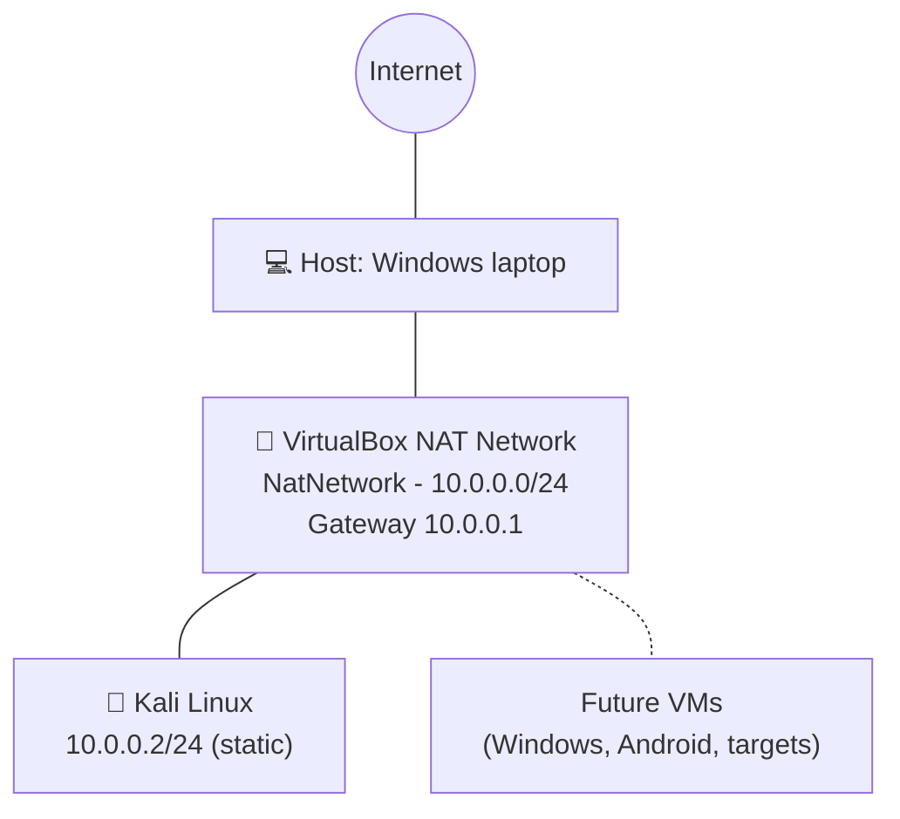

The NAT Network lets all VMs on the same subnet talk to each other, and reach the Internet through the host. Other machines can be added later as targets for authorized practice.

---

## ⚙️ Lab Configuration

| 🧩 Component | ⚙️ Configuration |
|---|---|
| 🖥️ Host OS | Windows |
| 🧰 Hypervisor | Oracle VirtualBox |
| 🐉 Attacker VM | Kali Linux 2026.3  |
| 🧠 Kali RAM | 2048 MB |
| 🌐 Network type | NAT Network, name `NatNetwork` |
| 📡 Subnet | `10.0.0.0/24` (DHCP server enabled on the NAT network) |
| 🐧 Kali IP address | `10.0.0.2/24` (static) |
| 🚪 Gateway | `10.0.0.1` |
| 🌍 DNS | `8.8.8.8` |
| 📁 Shared folder | Host `Downloads` (full access, auto-mount) |
| 📋 Clipboard / Drag & Drop | Bidirectional |
| 📸 Snapshot | `Kali_Clean_Config_10.0.0.2` |

---

# 🪜 Lab Setup Procedure

## Steps 1–2. Install 7-Zip and VirtualBox

7-Zip is needed to extract the Kali VM archive (`.7z`). VirtualBox was downloaded from the official site and installed. The VirtualBox Manager opens correctly:

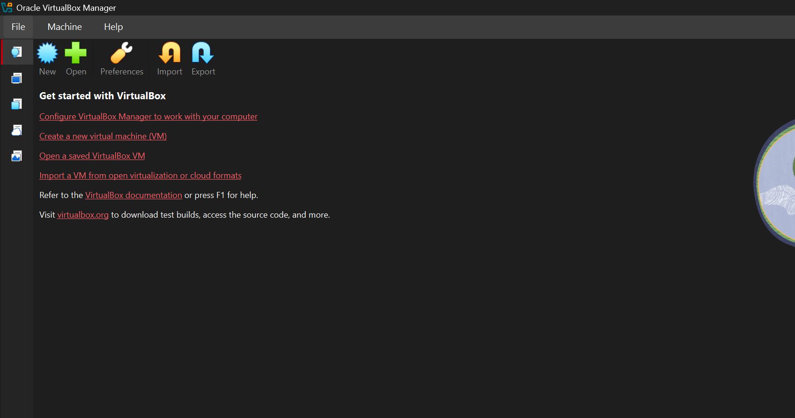

## Step 3. Create the NAT Network (10.0.0.0/24)

In VirtualBox: **File → Tools → Network → NAT Networks → Create**, then set:

- Name: `NatNetwork`
- IPv4 Prefix: `10.0.0.0/24`
- Enable DHCP: checked
- Enable IPv6: unchecked

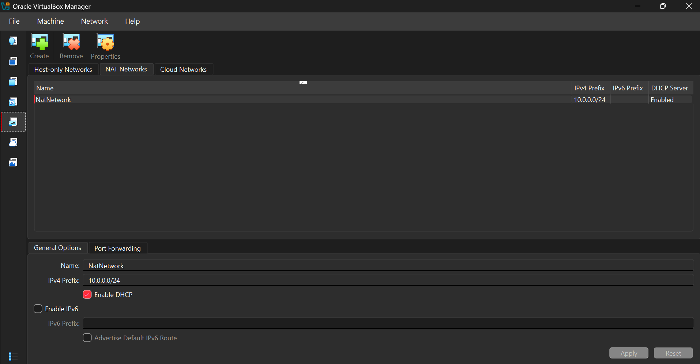

## Step 4. Import and configure the Kali Linux VM

I downloaded the prebuilt Kali VirtualBox image from the official Kali website, extracted it with 7-Zip, and added it to VirtualBox. The VM starts and the desktop is displayed:

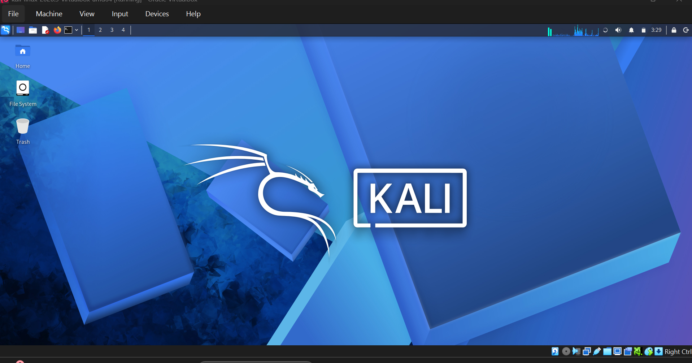

**Network:** Adapter 1 is attached to `NAT Network`, name `NatNetwork`, adapter type Intel PRO/1000 MT Desktop, virtual cable connected.

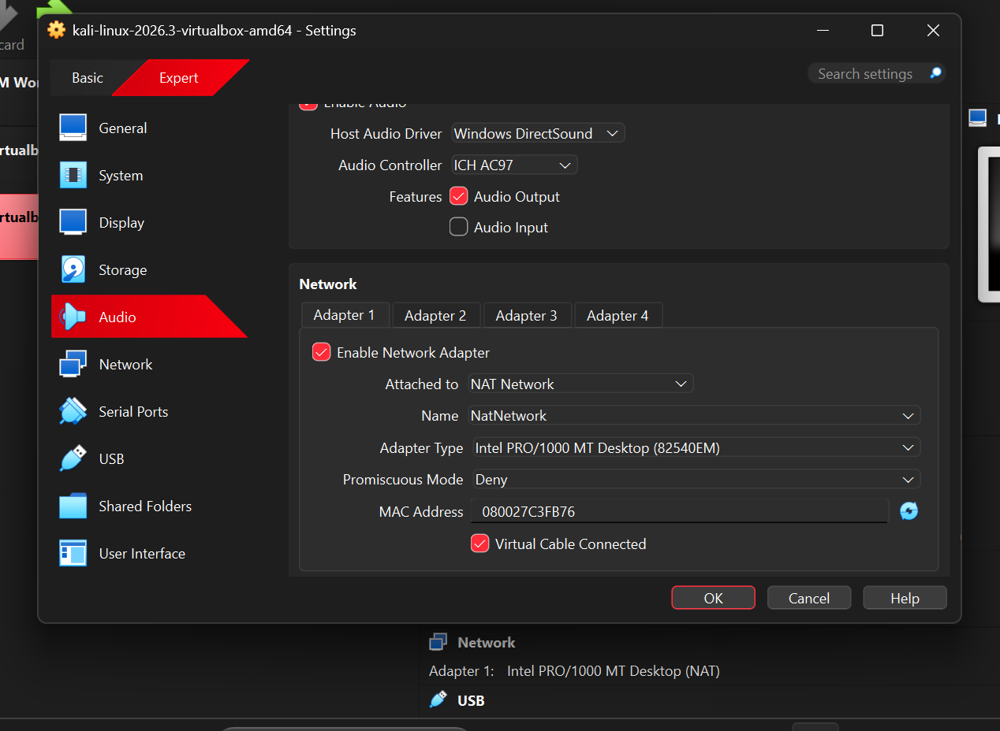

**Shared folder:** the `Downloads` folder of the host is shared with the VM as a machine folder, with full access and auto-mount enabled.

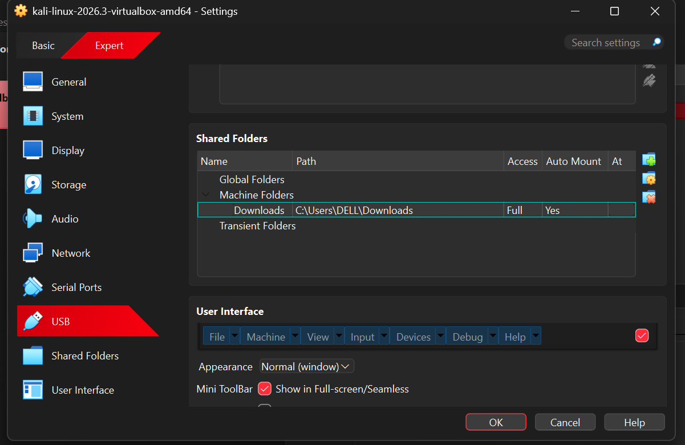

**Clipboard and drag & drop:** in **General → Features**, *Shared Clipboard* and *Drag-and-Drop* are both set to **Bidirectional**.

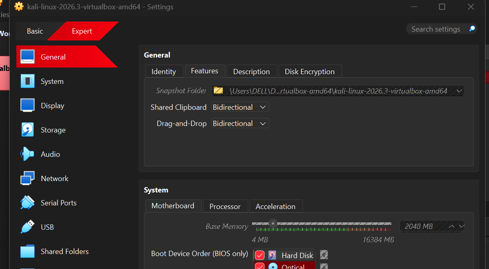

## Step 5. Configure the static IP address of Kali

The network icon was not available in the Kali panel (see *Problem 1*), so I did the configuration from the terminal with `nmcli`: manual IPv4 method, static address, gateway, DNS, and `dad-timeout 0` (recommended in the lab guide for VirtualBox 7 and recent Kali versions).

```bash
nmcli connection show
nmcli connection modify "Wired connection 1" ipv4.method manual ipv4.addresses 10.0.0.2/24 ipv4.gateway 10.0.0.1 ipv4.dns 8.8.8.8 ipv4.dad-timeout 0
sudo nmcli connection down "Wired connection 1"
sudo nmcli connection up "Wired connection 1"
ip a
```

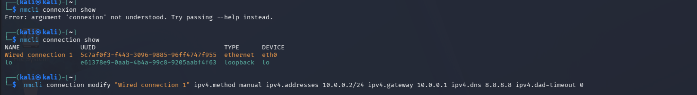

After reactivating the connection, `ip a` confirms that `eth0` has the address `10.0.0.2/24`:

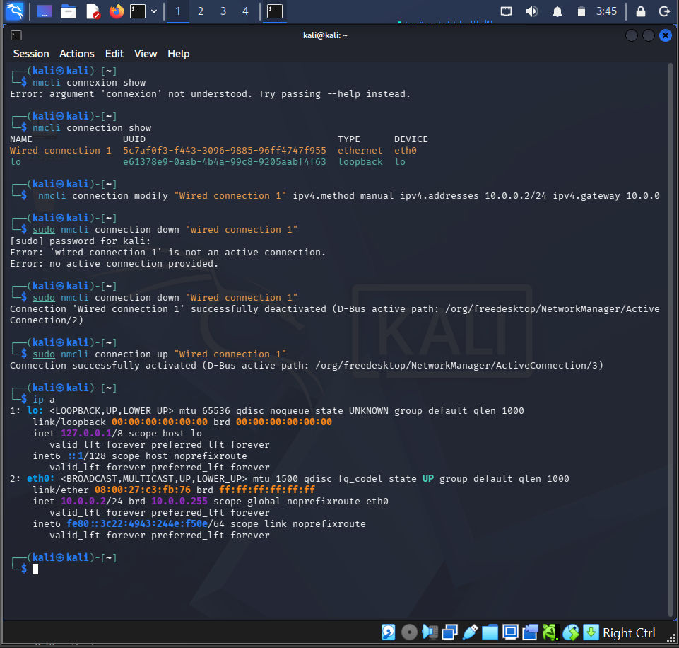

The routing table shows the default route through the NAT gateway:

```
default via 10.0.0.1 dev eth0 proto static metric 100
10.0.0.0/24 dev eth0 proto kernel scope link src 10.0.0.2 metric 100
```

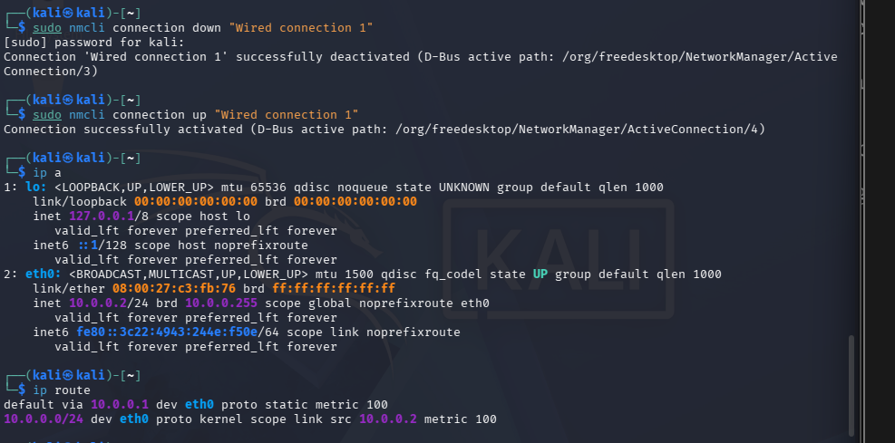

## Step 6. Take a snapshot of the VM

In VirtualBox Manager: select the Kali VM, open **Snapshots**, click **Take**, then give a name and a description.

- Name: `Kali_Clean_Config_10.0.0.2`
- Description: *Kali configuré : NATNetwork 10.0.0.0/24, IP 10.0.0.2/24, Internet OK, clipboard/drag-drop/shared folder activés*

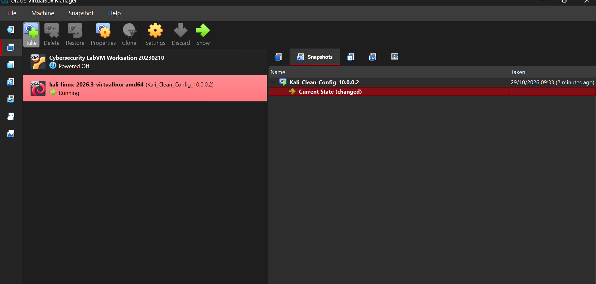

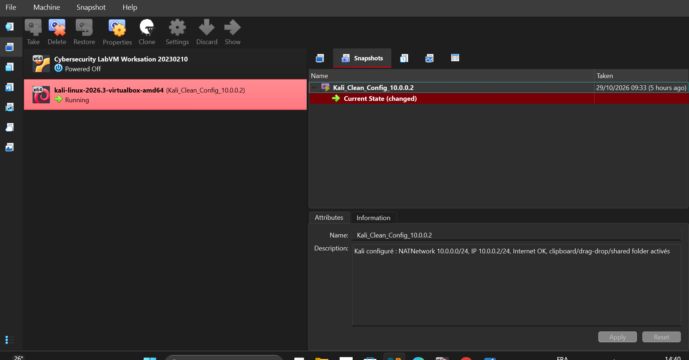

I can now come back to this clean state with **Restore** if something breaks during the next labs.

---

# 🔎 Lab Verification

| ✅ Test | 🧾 Command | 🎯 Result |
|---|---|---|
| IP address | `ip a` | `eth0` has `10.0.0.2/24` |
| Routing | `ip route` | Default route via `10.0.0.1` |
| Gateway | `ping -c 4 10.0.0.1` | Replies, about 1 ms |
| Internet by IP | `ping -c 4 8.8.8.8` | 0 % packet loss |
| DNS | `ping -c 4 google.com` | Name resolved |
| Real HTTPS test | `curl -I https://example.com` | `HTTP/2 200` |
| Tools | `nmap --version` | Nmap available |

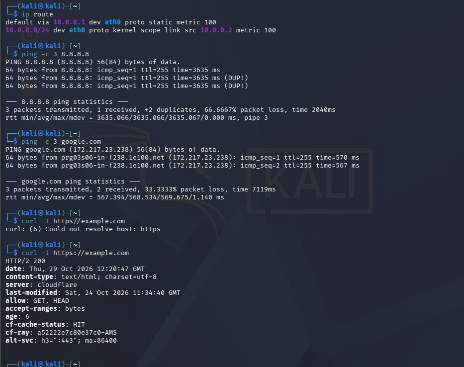

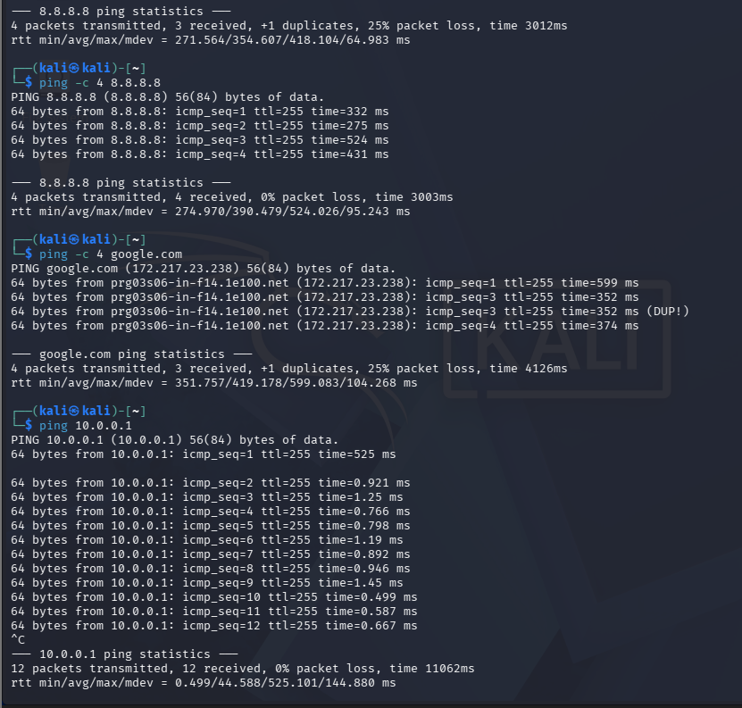

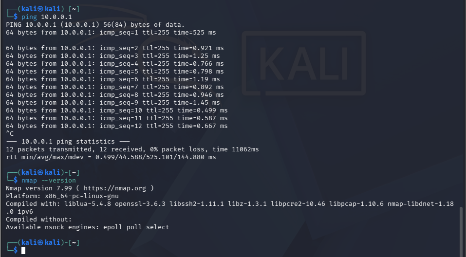

---

# 🐞 Problems Encountered & Solutions

## Problem 1. I could not find the network icon in Kali

**Problem:** the lab guide configures the IP address from the network icon in the Kali top panel (*Edit Connections → IPv4 Settings*). In my VM I could not find it, so I could not open the graphical connection editor.

**Solution:** I made the same configuration from the command line with NetworkManager's `nmcli` (commands in Step 5), with the same values as the guide. Then I restarted the connection and checked the result with `ip a` and `ip route`. Another option is to run `nm-connection-editor` in a terminal to open the graphical editor.

## Problem 2. Very slow ping, packet loss and duplicates to 8.8.8.8

The first test gave 66 % packet loss, a latency of about 3.6 seconds, and `DUP!` (duplicate) replies:

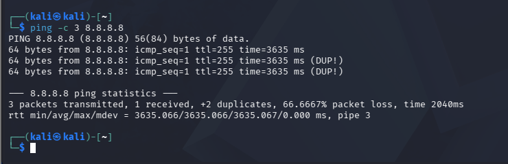

The reply came with `ttl=255`, which is the VirtualBox NAT engine answering, so a ping alone is not a reliable proof of Internet access.

**What I did:**

1. Checked the IP address and the default route (`ip a`, `ip route`): both were correct.
2. Reactivated the connection (`sudo nmcli connection down/up "Wired connection 1"`), with `ipv4.dad-timeout 0` set as recommended by the guide.
3. Tested again layer by layer: gateway (`10.0.0.1`), Internet by IP (`8.8.8.8`), DNS (`google.com`), then a real HTTPS request with `curl -I https://example.com`.

**Result:** 0 % loss to `8.8.8.8` and `curl` returned `HTTP/2 200`. The remaining latency to external hosts (about 270–520 ms) comes from the Internet connection of the host, while the local gateway answers in about 1 ms. If the Internet still fails, the guide also suggests `10.0.0.1` as DNS server instead of `8.8.8.8`.

## Problem 3. Small command errors

- `nmcli connexion show` → *argument 'connexion' not understood*. The command is `nmcli connection show` (English spelling).
- `sudo nmcli connection down "wired connection 1"` → *not an active connection*. Connection names are **case-sensitive**: it is `Wired connection 1`.
- `curl -I https//example.com` → *Could not resolve host: https*. The colon was missing: `https://example.com`.

---

# 💡 What I Learned

1. **NAT Network:** how it lets several VMs share one subnet, talk to each other, and reach the Internet through the host.
2. **Static IP with NetworkManager:** how to set it with `nmcli` even when the graphical tool is not available.
3. **Layer-by-layer testing:** gateway → IP → DNS → HTTPS, instead of trusting only `ping`.
4. **Snapshots:** they give a clean state to restore before risky labs.
5. **Documentation:** writing down commands, screenshots, problems and solutions is part of a professional security project.

---

# 🔐 Security & Ethical Use

This lab is strictly for education. It must only be used on systems that I own or on my own lab environment, or with written permission from the owner. Using these tools on anything else is illegal.

---

# 🔗 Tools & Resources

- **7-Zip:** https://7-zip.org/download.html
- **VirtualBox:** https://virtualbox.org/wiki/Downloads
- **Kali Linux:** https://kali.org/get-kali

---

# 👤 Author

**FOTSO  Verdiane**
Cybersecurity Intern – Networkwalks

LinkedIn: Https://www.linkedin.com/in/verdiane-fotso-8b4b1b308?

---

## 📌 Project Information

**Program:** Cybersecurity at Networkwalks | **Week:** 01 | **Project:** WK1-PM1 – Cybersecurity & Pentesting Lab Setup | **Repository:** GitHub

## 📂 Repository Content

```
.
├── README.md
└── screenshots/    (15 numbered screenshots)
```
